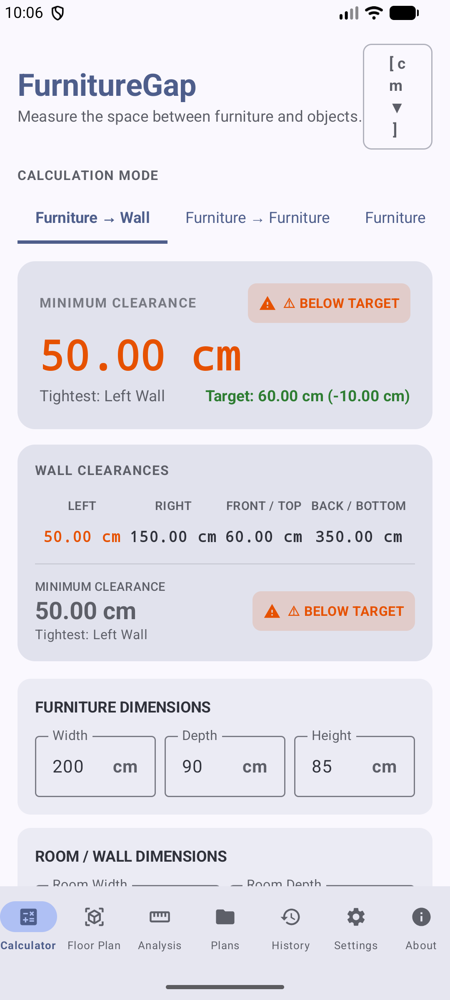
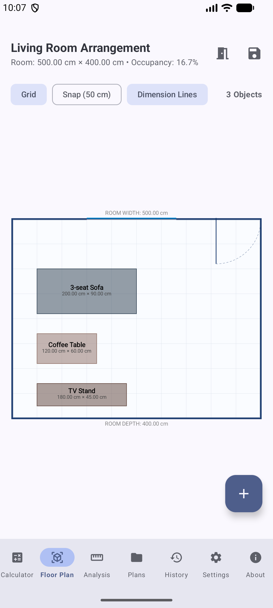
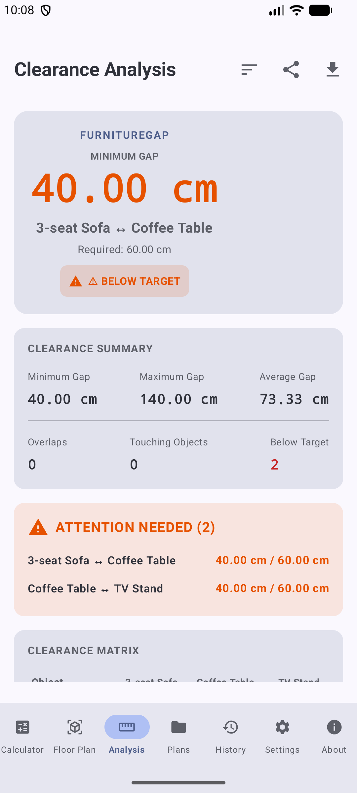
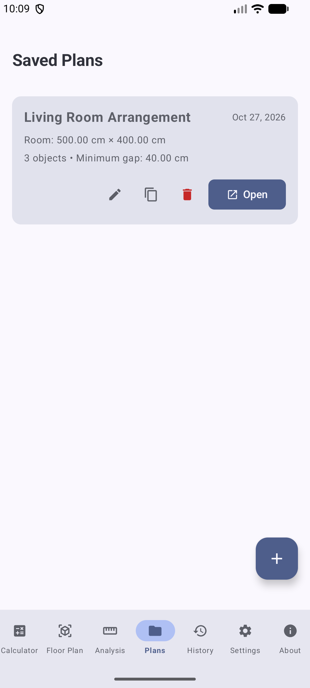
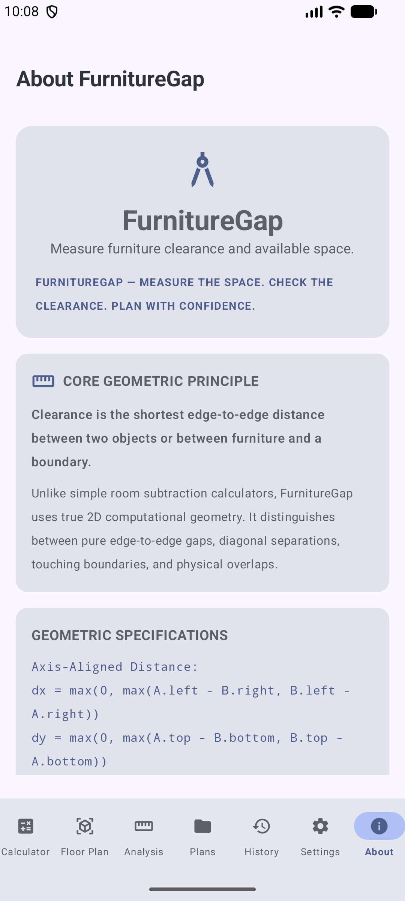

# FurnitureGap 📐🛋️

**FurnitureGap** is an advanced Android application designed to measure furniture clearance, available room space, walkway widths, door swing paths, and room occupancy using true 2D computational geometry. 

> *Measure the space. Check the clearance. Plan with confidence.*

---

## 📸 Screenshots

| Calculator Home | Interactive Floor Plan | Clearance Analysis |
| :---: | :---: | :---: |
|  |  |  |

| Saved Plans | Selected Object View |
| :---: | :---: |
|  |  |

---

## ✨ Features

- 📏 **True 2D Computational Geometry Engine**: Distinguishes between pure edge-to-edge gaps, diagonal separations, touching boundaries, and physical overlaps.
- 📐 **Interactive Floor Plan Designer**: Canvas view with drag-and-position support for furniture, doors, windows, and wall clearances.
- 🚪 **Door & Window Clearance Verification**: Calculates door swing arcs and checks for obstructions to ensure proper door opening paths.
- 🚶 **Walkway & Ergonomic Safety Analysis**: Evaluates room pathways against ergonomic and accessibility standards (Adequate, Tight, Warning, Overlap).
- 🧹 **Sweep-Line Occupancy Calculation**: Computes the exact area union of multi-rectangle layouts to strictly avoid double-counting overlapping items.
- 📁 **Plan Management & Export**: Save and load custom floor plans, and export floor plans and analysis to JSON, CSV, or formatted text reports.
- 📏 **Multi-Unit Support**: Seamlessly switch between Millimeters (`mm`), Centimeters (`cm`), Meters (`m`), Inches (`in`), and Feet (`ft`).
- 🎨 **Modern Material 3 UI**: Full dark/light theme support, dynamic colors, and responsive edge-to-edge design using Jetpack Compose.

---

## 🧮 Geometric & Mathematical Specifications

Unlike basic room subtraction tools, **FurnitureGap** relies on strict geometric principles:

### 1. Axis-Aligned Rectangle Distance
$$\Delta x = \max(0, \max(A_{\text{left}} - B_{\text{right}}, B_{\text{left}} - A_{\text{right}}))$$
$$\Delta y = \max(0, \max(A_{\text{top}} - B_{\text{bottom}}, B_{\text{top}} - A_{\text{bottom}}))$$
$$\text{Distance} = \sqrt{\Delta x^2 + \Delta y^2}$$

### 2. Room Occupancy & Area Union
Furniture area coverage is calculated using a **sweep-line algorithm**, guaranteeing accurate net floor area calculation regardless of overlapping furniture pieces.

---

## 🛠️ Tech Stack & Architecture

- **Language**: [Kotlin](https://kotlinlang.org/)
- **UI Framework**: [Jetpack Compose](https://developer.android.com/jetpack/compose) (Material 3)
- **Architecture**: MVVM with Unidirectional Data Flow (UDF)
- **State Management**: Kotlin `StateFlow` & `ViewModel`
- **Navigation**: Navigation Compose
- **Target SDK**: Android 14+ (API 34/35)

---

## 🚀 Getting Started

### Prerequisites
- [Android Studio](https://developer.android.com/studio) (Ladybug or newer recommended)
- JDK 17+
- Android SDK 35

### Building from Source

1. Clone the repository:
   ```bash
   git clone https://github.com/abdullah-ateeq/FurnitureGap.git
   cd FurnitureGap
   ```
2. Open the project in Android Studio.
3. Build and run the app on an emulator or physical device:
   ```bash
   ./gradlew installDebug
   ```

---

## 📄 License

This project is open source and available under the [MIT License](LICENSE).
